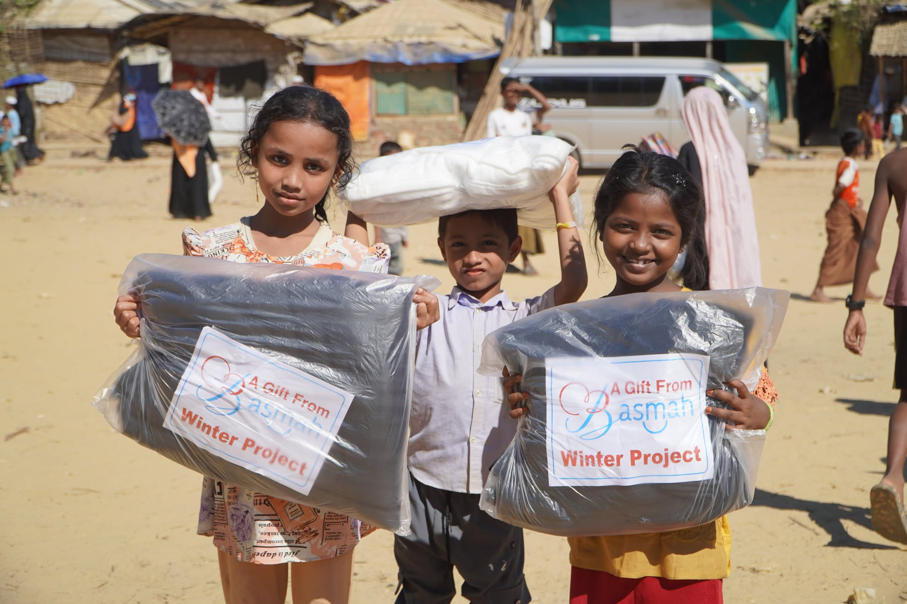

# Kindora

**Kindora** is a community event platform for discovering, creating, and joining volunteering, donation, and charity events.

Built with **Next.js 16**, **React 19**, **TypeScript**, **Tailwind CSS v4**, **Better Auth**, and **MongoDB**.

[](https://kindora-fronted.vercel.app)
[](https://kindora-backend-five.vercel.app)



---

## 🔗 Links

| Resource | Link |
| --- | --- |
| 🌐 Live Website | https://kindora-fronted.vercel.app |
| ⚙️ Live Backend API | https://kindora-backend-five.vercel.app |
| 💻 Frontend Repository | https://github.com/0MarufHasan0/cat-hermione-client |
| 🗄️ Backend Repository | https://github.com/0MarufHasan0/cathermioneser-server |
| 👤 Author | https://github.com/0MarufHasan0 |

---

## ✨ Features

- **Authentication** — Email/password and Google sign-in with Better Auth
- **Protected routes** — Server-side session checks with the Next.js proxy
- **Event discovery** — Browse events and filter them by category
- **Event details** — Full event page with location, date, and description
- **Event creation** — Publish events with images, dates, and locations
- **Event management** — Edit and delete your own events
- **Join events** — Join or cancel participation at any time
- **JWT-protected API** — Every backend request is verified with a signed JWT
- **Dark mode** — System-aware theme switching
- **Responsive UI** — Mobile-first layouts with a slide-out navigation menu
- **Polished states** — Loading skeletons, toast notifications, and a custom 404 page

---

## 🧰 Tech Stack

| Layer | Technology |
| --- | --- |
| Framework | Next.js 16 (App Router, Turbopack) |
| UI | React 19, shadcn/ui, Base UI |
| Language | TypeScript |
| Styling | Tailwind CSS v4 |
| Icons | Lucide React |
| Auth | Better Auth (JWT plugin + MongoDB adapter) |
| Database | MongoDB |
| Notifications | React Toastify |
| Fonts | DM Sans, Lora, Geist Mono |
| Hosting | Vercel (client + server) |

---

## 🏗️ Architecture

```text
Browser (Next.js client)
        │
        ├── Better Auth ──────► MongoDB (users / sessions)
        │        │
        │        └── JWT ─────► Express API on Vercel
        │                              │
        └──── fetch(apiUrl()) ─────────┴──► MongoDB (events)
```

- **Client:** Next.js App Router, server components by default, `"use client"` where needed.
- **Backend:** Express 5 running as a Vercel Node function (`cathermioneser-server`).
- **Auth:** Better Auth issues a JWT; the API verifies it against the client's JWKS endpoint.
- **API base URL:** one shared helper in `src/lib/api.ts` keeps every request consistent.

---

## 🚀 Getting Started

### Prerequisites

- Node.js 20+
- npm
- MongoDB database
- The backend API running (local or deployed)

### 1. Clone the repositories

```bash
# Frontend
git clone https://github.com/0MarufHasan0/cat-hermione-client.git
cd cat-hermione-client

# Backend (separate terminal)
git clone https://github.com/0MarufHasan0/cathermioneser-server.git
cd cathermioneser-server
```

### 2. Install dependencies

```bash
npm install
```

### 3. Configure environment variables

```bash
cp .env.example .env
```

```env
# Backend API base URL used by the client
NEXT_PUBLIC_BASE_URI=http://localhost:8000

# Better Auth
BETTER_AUTH_SECRET=your-secret
BETTER_AUTH_URL=http://localhost:3000
BETTER_AUTH_MONGO_URI=your-mongodb-connection-string

# Google OAuth
GOOGLE_CLIENT_ID=your-google-client-id
GOOGLE_CLIENT_SECRET=your-google-client-secret
```

The backend needs its own `.env`:

```env
MONGODB_BASE_URI=your-mongodb-connection-string
CLIENT_URI=http://localhost:3000
```

> `CLIENT_URI` must point to the frontend URL, because the API verifies JWTs against
> `<CLIENT_URI>/api/auth/jwks`.

### 4. Run the apps

```bash
# Frontend → http://localhost:3000
npm run dev

# Backend → http://localhost:8000
node index.js
```

---

## 🔐 Environment Variables

### Client

| Variable | Required | Description |
| --- | --- | --- |
| `NEXT_PUBLIC_BASE_URI` | ✅ | Base URL of the backend API |
| `BETTER_AUTH_SECRET` | ✅ | Secret used by Better Auth |
| `BETTER_AUTH_URL` | ✅ | Public URL of the Next.js app |
| `BETTER_AUTH_MONGO_URI` | ✅ | MongoDB connection string |
| `GOOGLE_CLIENT_ID` | ✅ | Google OAuth client ID |
| `GOOGLE_CLIENT_SECRET` | ✅ | Google OAuth client secret |

### Server

| Variable | Required | Description |
| --- | --- | --- |
| `MONGODB_BASE_URI` | ✅ | MongoDB connection string |
| `CLIENT_URI` | ✅ | Frontend URL used to fetch the JWKS keys |

> `.env` files are ignored by Git. Use `.env.example` as the template.

---

## 📜 Scripts

| Command | Description |
| --- | --- |
| `npm run dev` | Start the development server |
| `npm run build` | Create a production build |
| `npm start` | Start the production server |
| `npm run lint` | Run ESLint |
| `npx tsc --noEmit` | Typecheck the project |

---

## 🗺️ Routes

| Route | Description | Access |
| --- | --- | --- |
| `/` | Landing page with hero and upcoming events | Public |
| `/sign-in` | Sign in with email or Google | Public |
| `/sign-up` | Create a new account | Public |
| `/upcoming-events` | Browse and filter all events | Protected |
| `/upcoming-events/[id]` | Event details page | Protected |
| `/create-event` | Create a new event | Protected |
| `/my-event` | Manage events you created | Protected |
| `/join-event` | View and cancel joined events | Protected |
| `/api/auth/[...all]` | Better Auth API handler | Public |

---

## 🔌 API Endpoints

Base URL: `https://kindora-backend-five.vercel.app`

| Method | Endpoint | Description | Auth |
| --- | --- | --- | --- |
| `GET` | `/` | Health check | ❌ |
| `GET` | `/add-kindora` | List all events | ❌ |
| `POST` | `/add-kindora` | Create an event | ✅ |
| `GET` | `/events?category=&limit=` | List/filter events | ✅ |
| `GET` | `/kindora/:id` | Get a single event | ✅ |
| `PATCH` | `/kindora/:id` | Update an event | ✅ |
| `DELETE` | `/kindora/:id` | Delete an event | ✅ |
| `GET` | `/my-kindora/:email` | Events created by a user | ✅ |
| `POST` | `/join-event` | Join an event | ✅ |
| `GET` | `/joined-event/:email` | Events joined by a user | ✅ |
| `DELETE` | `/joined-event/:id` | Cancel a joined event | ✅ |

Authenticated requests must send:

```http
Authorization: Bearer <jwt>
```

---

## 📁 Project Structure

```text
src/
├── app/
│   ├── (auth)/
│   │   ├── sign-in/
│   │   └── sign-up/
│   ├── (event-management)/
│   │   ├── create-event/
│   │   ├── join-event/
│   │   └── my-event/
│   ├── api/
│   │   ├── auth/[...all]/
│   │   └── debug-session/
│   ├── upcoming-events/
│   │   ├── [id]/
│   │   └── page.tsx
│   ├── apple-icon.png
│   ├── favicon.ico
│   ├── globals.css
│   ├── icon.svg
│   ├── layout.tsx
│   ├── loading.tsx
│   ├── not-found.tsx
│   └── page.tsx
├── components/
│   ├── layout/navbar.tsx
│   ├── ui/                  # shadcn/ui primitives
│   ├── create-event-form.tsx
│   ├── event-skeletons.tsx
│   ├── hero.tsx
│   └── ...
├── lib/
│   ├── api.ts
│   ├── auth.ts
│   └── auth-client.ts
└── proxy.ts
```

---

## ☁️ Deployment

Both apps are deployed on **Vercel**.

### Client

1. Import `cat-hermione-client` into Vercel.
2. Add every variable from `.env.example`.
3. Set `NEXT_PUBLIC_BASE_URI` to the deployed backend URL.
4. Set `BETTER_AUTH_URL` to the deployed frontend URL.
5. Deploy.

### Server

1. Import `cathermioneser-server` into Vercel.
2. Add `MONGODB_BASE_URI` and `CLIENT_URI` (the deployed frontend URL).
3. `vercel.json` routes every request to `index.js`.
4. Deploy.

> Keep both deployments in sync: changing `CLIENT_URI` or `NEXT_PUBLIC_BASE_URI`
> requires a redeploy so the new value is picked up.

---

## 👤 Author

**Md. Maruf Hasan**

- GitHub: [@0MarufHasan0](https://github.com/0MarufHasan0)
- Frontend: [cat-hermione-client](https://github.com/0MarufHasan0/cat-hermione-client)
- Backend: [cathermioneser-server](https://github.com/0MarufHasan0/cathermioneser-server)

---

<p align="center">
  Made with 💛 for communities that care.
</p>
